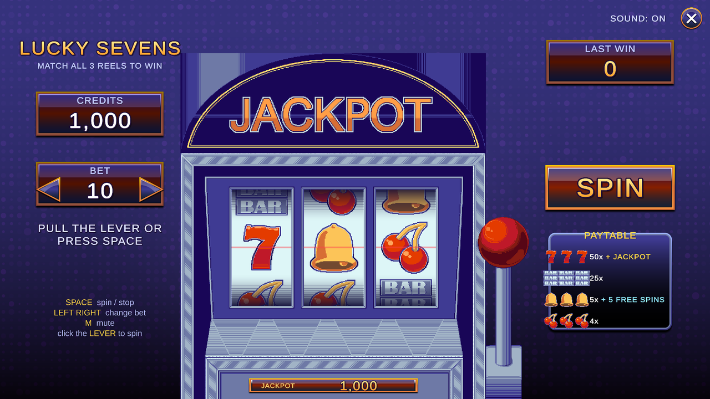
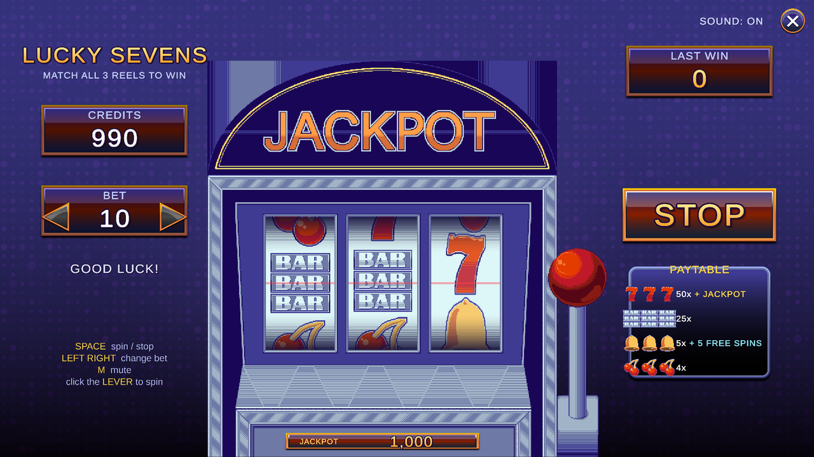
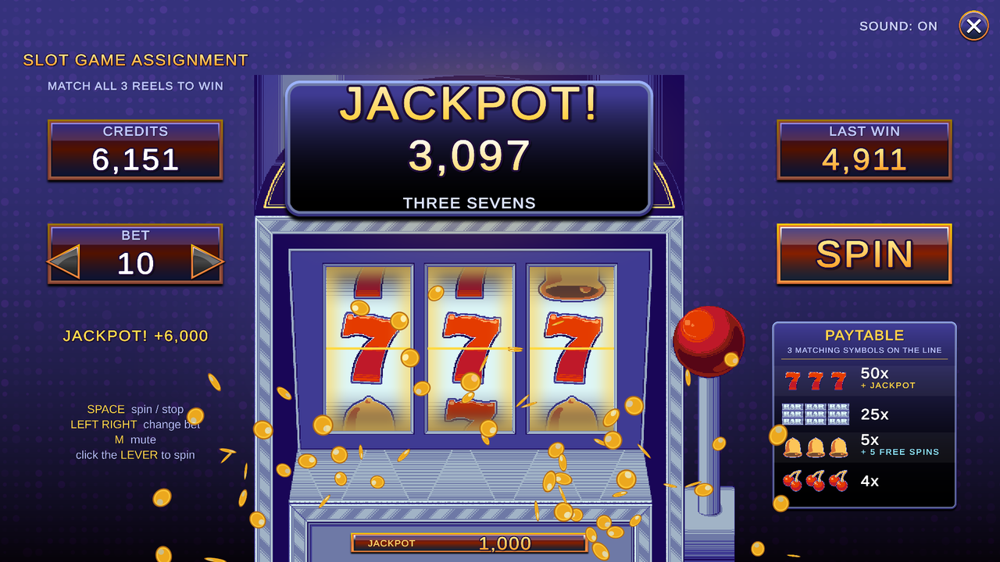

# Lucky Sevens: Unity Slot Machine

A classic 3 reel slot machine built in Unity 6 for the Underpin Technology Unity Developer Intern assignment.
It uses the art pack provided with the assignment (cabinet, symbols, buttons, popup) and adds the game logic,
reel animation, sound, UI and a couple of bonus features on top.



| Anticipation on the last reel | Jackpot |
| --- | --- |
|  |  |

---

## Game overview

- 3 reels, 1 payline (the red line through the middle of the windows).
- **You win when all 3 reels land on the same symbol**, exactly as the brief describes. Two of a kind pays nothing.
- Pick a bet of 10, 50 or 100 credits, then pull the lever, hit SPIN or press Space.
- You start with 1,000 credits. Credits and the jackpot pool are saved between sessions.

### Paytable (multiplier of your bet)

| Symbols | Pays | Extra |
| --- | --- | --- |
| 7 7 7 | 50x | + progressive jackpot |
| BAR BAR BAR | 25x | |
| Bell Bell Bell | 5x | + 5 free spins |
| Cherry Cherry Cherry | 4x | |

### Controls

| Input | Action |
| --- | --- |
| Click the lever / SPIN button / Space / Enter | Spin |
| Same again while the reels are moving | Slam stop (stops all reels quickly) |
| Same again during a win celebration | Skip it and spin again |
| Left / Right arrows (or the arrow buttons) | Change bet |
| M or the SOUND button | Mute |
| X button (top right) | Reset credits |

---

## Running the WebGL build

The build is in [`Build/WebGL`](Build/WebGL). Unity WebGL builds need to be served over HTTP, opening
`index.html` straight from disk won't work because the browser blocks loading the `.wasm` / data files.

Any static server works. From the repo root:

```bash
# Python 3
cd Build/WebGL
python -m http.server 8000
# then open http://localhost:8000
```

```bash
# or Node
npx serve Build/WebGL
```

The build uses gzip compression with **decompression fallback** turned on, so it runs on servers that don't
send `Content-Encoding` headers (python http.server, GitHub Pages, itch.io).

### Opening the project in the editor

1. Unity **6000.4.10f1** (Unity 6.4). Other Unity 6 versions should be fine too.
2. Open the repo folder in Unity Hub, open `Assets/Scenes/Main.unity` and press Play.
3. To make a WebGL build yourself: Tools > Slot Game > Build WebGL (writes to `Build/WebGL`), or from the command line:
   `Unity -batchmode -quit -projectPath . -buildTarget WebGL -executeMethod SlotGame.EditorTools.WebGLBuilder.Build`

---

## Features

### Core (from the brief)
- **Winning logic**: all reels must match (`PayoutCalculator.AllSymbolsMatch`).
- **Smooth reel animation**: each reel winds up slightly backwards, accelerates, spins at full speed with a
  vertical stretch (cheap motion blur), then eases into the target symbol with a small overshoot bounce.
  Reels stop left to right with a stagger.
- **Clean symbol display**: the 96 px symbols sit on a fixed 105 px grid, centred on the payline, rendered with
  point filtering so the pixel art stays sharp. A shade gradient on the top and bottom of each window sells the
  curved drum look.
- **RNG**: outcomes come from a cryptographic RNG (`System.Security.Cryptography.RandomNumberGenerator`) with
  rejection sampling, so there's no modulo bias. Details below.
- **Payouts**: per symbol multipliers, tunable in `Assets/Data/SlotSettings.asset`.

### Bonus features
- **Progressive jackpot**: 5% of every paid bet goes into a pool shown on the cabinet. Three 7s pay 50x plus the
  pool. The share you get scales with your bet (max bet = whole pool), like real progressive machines, so
  there's a reason to bet higher. The pool resets to 1,000 after it's won.
- **Free spins**: three Bells award 5 free spins. They play automatically, don't cost credits, all wins are
  doubled and the bet is locked to the one that triggered them. Bells during free spins add 5 more.
- **Anticipation**: if the first two reels already match, the last reel keeps spinning for an extra beat,
  speeds up, glows and plays a riser. (Pure presentation, the result was decided before the reels started.)
- **Slam stop and skip**: experienced players can stop the reels early or skip celebrations.

### Game feel
- Every action gets a visible and audible response: lever pull animation, reel stop thunks with a small cabinet
  shake, a breathing SPIN button while idle.
- Numbers never snap: credits, last win and the jackpot all roll up, with coin ticks while credits count.
- Wins are tiered by size: small wins pulse the symbols and blink the payline gold; big wins (10x+) add a
  banner, flash and a coin burst; the jackpot adds a bigger shake and flash.

### Sound
No audio came with the asset pack, so I generated the sound effects with the ElevenLabs sound effects API
(lever, reel loop, reel stop, anticipation riser, win jingles, jackpot fanfare, coin tick, ambience).
They're in `Assets/Sounds`.

---

## Approach / thought process

**1. Logic first, no Unity.** I started with the rules as plain C# in `Assets/Scripts/Core` with its own assembly
definition marked `noEngineReferences`. That forces the game logic to stay independent of rendering and makes it
easy to unit test. `SlotMachine` owns the wallet, bet, reels, jackpot and free spins and turns a spin request
into an immutable `SpinResult`.

**2. Decide the outcome, then animate it.** A spin is resolved the instant the player presses the button (bet
taken, symbols picked, payout calculated). The reels then play that result back. This is how real machines
work, it keeps the RNG and the animation completely separate, and means animation tricks like anticipation or
slam stop can never change the result.

**3. Weighted virtual reels.** Each reel picks a symbol by weight (Cherry 12, Bell 9, Bar 7, Seven 4 out of 32).
I tuned weights and payouts using `RtpSimulator` (Tools > Slot Game > Simulate RTP), which plays 1M spins
headlessly. Current numbers at max bet:

| Metric | Value |
| --- | --- |
| Return to player | ~92 to 93% |
| Hit rate | ~9.9% (about 1 in 10 spins) |
| Jackpot | about 1 in 450 spins |
| Free spins trigger | about 1 in 40 spins |

**4. Fair RNG.** `CryptoRandomNumberGenerator` reads 32 random bits from the OS crypto source and uses rejection
sampling: values from the last incomplete bucket are thrown away and redrawn, so every outcome is exactly equally
likely. The `IRandomNumberGenerator` interface lets tests and the simulator use a seeded generator instead so
results are reproducible. Visual filler symbols on the reels use a separate cosmetic `System.Random`.

**5. Reel animation maths.** Each reel is an endless virtual strip indexed by integers with a float scroll
position; 5 recycled symbol views are positioned around it every frame. When the stop comes in, the reel works
out how far it has to travel so that an `OutBack` ease starting at its *current speed* lands exactly on a whole
cell. Matching the start slope of the curve to the current speed is what removes the hitch you usually see when
a reel switches from spinning to stopping. The target symbol is written into the strip while it's still above
the window, so it never pops in.

**6. Presentation split into small components.** `ReelSetController` (spin choreography), `WinPresenter`
(celebration), `HudView` (display only), `AudioManager`, `PopupDialog`, `WinBanner`. `SlotGameController` is the
only class that talks to the model and wires everything together with a simple Idle > Spinning > Presenting
state machine.

**7. Animator vs code.** The lever pull and popup open/close are authored animation clips (`Assets/Animations`)
because they're fixed one-shot motions. Reel motion, counters, shakes and the coin burst are code tweens through
a tiny `Ease` helper because they depend on runtime values. I skipped DOTween to keep the project dependency free.

---

## Project structure

```
Assets/
  Animations/     Lever + popup animation clips and controllers
  Data/           SlotSettings (odds/payouts), SymbolSpriteLibrary, SoundLibrary
  Prefabs/        Reel, SymbolView, Coin, PopupDialog, WinBanner
  Scenes/         Main.unity
  Scripts/
    Core/         Pure C# game logic + RNG (own asmdef, no UnityEngine)
    Reels/        ReelView, ReelSetController, SymbolView, SymbolSpriteLibrary
    Game/         SlotGameController, WinPresenter, SlotSettings, SaveSystem
    UI/           HudView, CountUpText, PopupDialog, WinBanner, LeverView
    Feel/         Ease/tween helper, UiShake, ScreenFlash, CoinBurst
    Audio/        AudioManager, SoundLibrary
    Editor/       RTP simulator menu
  Sounds/         Sound effects
  Tests/EditMode/ NUnit tests for payouts, RNG, jackpot, free spins, RTP range
  UI/             Sprites from the asset pack (machine, symbols, buttons, panels) + text materials
Build/WebGL/      Playable WebGL build
Docs/             Reference gif from the asset pack + screenshots
```

## Tests

Window > General > Test Runner > EditMode > Run All. 23 tests covering the paytable, the "all must match" rule,
RNG range and rough uniformity, reel weights, wallet rules, bet clamping, jackpot growth/award/reset, free spins
(no cost, bet lock, 2x multiplier) and a sanity check that the RTP stays in a sensible range.

## Notes and assumptions

- The brief only defines "all symbols match" as a win, so I kept it strict: no two of a kind or cherry pays.
- The asset pack has 4 symbols, so the bonus features reuse them (7 = jackpot, Bell = free spins) instead of
  adding new art.
- Credits are play money only.
- Possible next steps: more paylines, autoplay, a proper AudioMixer with music/sfx sliders, and a history panel
  of the last spins.

## Credits

- Art: asset pack provided with the assignment.
- Sound effects: generated with ElevenLabs.
- Font: Liberation Sans (SIL Open Font License), via TextMesh Pro.
